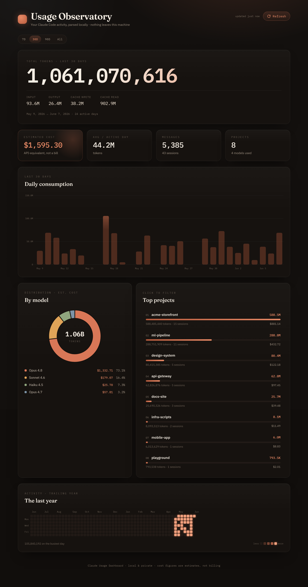

# Claude Usage Dashboard

A beautiful, private, local-first web dashboard that visualizes your **Claude Code** usage — token consumption, daily trends, model split, project breakdown, and a GitHub-style activity heatmap.

Everything runs on your machine. **No data ever leaves your computer.**



<sub>Screenshot uses synthetic demo data (`scripts/generate_sample_logs.py`) — not real usage.</sub>

**Tech Stack**
- Backend: FastAPI (Python)
- Frontend: SvelteKit + TypeScript + Tailwind CSS v4
- Charts: Chart.js + custom-built heatmap
- Data source: your local Claude Code JSONL logs (`~/.claude/projects`)

---

## What it shows

- **Total tokens** — with an honest breakdown of input / output / cache-write / cache-read
- **Estimated cost** — API-equivalent dollar estimate (not your subscription bill)
- **Time-range selector** — scope the whole dashboard to 7D / 30D / 90D / All
- **Project drill-down** — click any project to filter the entire dashboard to it
- **KPIs** — estimated cost, avg tokens/active day, messages, sessions, projects, models
- **Daily consumption** — bar chart over the selected range
- **By model** — donut chart with per-model cost (Opus / Sonnet / Haiku, etc.)
- **Top projects** — ranked, clickable usage bars with cost
- **Activity heatmap** — calendar of the trailing year
- **Refresh** — re-scan your logs without restarting

> **On cost:** Claude Code is a subscription — it is *not* billed per token. The cost
> figures here estimate what the same tokens would cost on the Anthropic API, for
> perspective only. They are clearly labeled as estimates, not a bill.

---

## Quick Start

You'll need **Python 3.10+** and **Node 18+**.

### 1. Backend (terminal 1)

```bash
cd backend
python -m venv .venv

# macOS / Linux
source .venv/bin/activate
# Windows (PowerShell)
# .venv\Scripts\Activate.ps1

pip install -r requirements.txt
uvicorn main:app --reload --port 8000
```

The API now runs at `http://localhost:8000` (try `http://localhost:8000/api/health`).

### 2. Frontend (terminal 2)

```bash
cd frontend
npm install
npm run dev
```

Open the URL it prints (usually `http://localhost:5173`).

That's it — the dashboard reads your logs automatically.

> **Compatibility:** This reads Claude Code's local session logs
> (`~/.claude/projects/**/*.jsonl`, using the `message.usage` token fields). That
> format is undocumented and may change between Claude Code versions — this was
> built and tested against Claude Code as of June 2026. If a future version shifts
> the schema, the parser in `backend/services/log_parser.py` is the one place to adjust.

---

## Configuration

By default the backend reads logs from `~/.claude/projects`. To point it
somewhere else, set an environment variable before launching:

```bash
# macOS / Linux
export CLAUDE_LOGS_DIR="/path/to/.claude/projects"

# Windows (PowerShell)
$env:CLAUDE_LOGS_DIR = "C:\path\to\.claude\projects"
```

---

## API

All endpoints are read-only and local-only.

Most stats endpoints accept optional filters: `start` / `end` (ISO `yyyy-mm-dd`,
inclusive) and `project` (name).

| Method | Endpoint                | Description                              |
|--------|-------------------------|------------------------------------------|
| GET    | `/api/health`           | Health check                             |
| GET    | `/api/stats/summary`    | Totals, breakdown, estimated cost, KPIs  |
| GET    | `/api/stats/daily`      | Tokens per day (range or `days`)         |
| GET    | `/api/stats/models`     | Usage + cost split by model              |
| GET    | `/api/stats/projects`   | Usage + cost split by project            |
| GET    | `/api/stats/heatmap`    | Per-day activity (trailing year)         |
| POST   | `/api/refresh`          | Re-scan log files from disk              |

Examples: `/api/stats/summary?start=2026-05-01&end=2026-05-31`,
`/api/stats/models?project=my-app`.

Logs are parsed once into an in-memory cache; every endpoint reads from it,
so page loads are fast. `POST /api/refresh` rebuilds the cache.

---

## Project Structure

```
claude-usage-dashboard/
├── PRD.md                       # Product Requirements Document
├── CLAUDE.md                    # Rules & instructions for Claude Code
├── README.md
├── specs/                       # Feature specifications
├── backend/
│   ├── main.py                  # FastAPI app + routes
│   ├── requirements.txt
│   └── services/
│       ├── log_parser.py        # Discovers & parses JSONL logs
│       ├── pricing.py           # Estimated per-model API pricing
│       └── stats.py             # Filtering + aggregations + in-memory cache
└── frontend/
    └── src/
        ├── app.css              # "Observatory" design system
        ├── lib/
        │   ├── api.ts           # Backend client (with filters)
        │   ├── types.ts         # Shared types
        │   ├── format.ts        # Number / date / money formatting
        │   ├── ranges.ts        # Time-range presets
        │   ├── palette.ts       # Chart colors
        │   └── components/      # KpiCard, DailyChart, ModelDonut, Heatmap,
        │                        # ProjectList, RefreshButton, RangeSelector
        └── routes/
            └── +page.svelte     # The dashboard
```

---

## Privacy

- 100% local. The backend only **reads** files under your Claude logs directory.
- No telemetry, no external network requests, no authentication.
- The frontend talks only to your local backend on `localhost:8000`.

---

## Philosophy

- Everything is local and private
- Beautiful but not bloated
- Built iteratively with clear specs

---

## License

MIT — see [LICENSE](LICENSE).

Good luck building on it!
