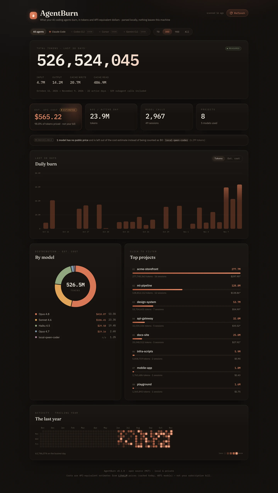

<div align="center">

# 🔥 AgentBurn

**What your AI coding agents burn — in tokens and API-equivalent dollars.**

A local-first, open-source dashboard for Claude Code, Codex CLI, Cursor, Grok Build and Grok Bot.
One command, a polished web UI, and honest numbers: every figure says whether it was
**measured**, **estimated** or is **unavailable**.

```bash
npx agentburn
```



</div>

## Why

Terminal tools like [ccusage](https://github.com/ccusage/ccusage) and
[tokscale](https://github.com/junhoyeo/tokscale) are great. AgentBurn is for when you
want to *look* at your usage: a calm, fast web dashboard that opens with one command,
works across agents, and is explicit about where every number comes from.

- **One command.** `npx agentburn` scans your logs, starts a server on `localhost`, opens your browser.
- **Honest provenance.** Tokens are *measured* from your agent's logs. Cost is an
  *estimate* at public API prices. Models without a public price are flagged as
  *unavailable* and left out of the total — never silently counted as $0.
- **Correct counts.** Claude Code writes one API response as several log lines and copies
  messages into resumed sessions. AgentBurn de-duplicates them (see [How counting works](#how-counting-works)),
  which a naive line-by-line sum counts two or three times.
- **100% local.** Your logs never leave your machine. No accounts, no telemetry.

## Features

- Total tokens with input / output / cache write / cache read breakdown
- Estimated API-equivalent cost, with the share of tokens that could be priced
- 7D / 30D / 90D / All ranges, filter by agent and by project (click a project to drill down)
- One overview across agents: daily burn chart stacked by agent (tokens or cost), model split,
  top projects, a year-long activity heatmap
- Per-agent cards: detected / not found / planned, where AgentBurn looked, how to get data in,
  and how much of each agent's usage has measured tokens
- Subagent (sidechain) calls included and labelled
- Refresh re-scans logs without restarting

## Install & run

Requires Node.js 20+.

> **Pre-release:** the package is not on npm yet. Until it is, run it from source:
> `git clone … && npm install && npm run build && node dist/server/cli.js`
> (or `npm pack` and `npx ./agentburn-0.1.0.tgz`).

```bash
npx agentburn                # scan, serve on http://localhost:4317, open the browser
npx agentburn --no-open      # don't open the browser
npx agentburn --offline      # never download prices (uses cache or the bundled table)
npx agentburn --port 8080    # pick a port (falls back to the next free one)
npx agentburn --claude-dir ~/backup/claude/projects
```

Or install globally: `npm i -g agentburn && agentburn`.

| Option / env | What it does |
| --- | --- |
| `-p, --port` / `PORT` | Port (default `4317`) |
| `--host` | Interface to bind (default `127.0.0.1`, loopback only) |
| `--no-open` | Don't open a browser |
| `--offline` / `AGENTBURN_OFFLINE=1` | Skip the price download |
| `--claude-dir` / `CLAUDE_LOGS_DIR` | Claude Code log root(s), comma-separated |
| `CLAUDE_CONFIG_DIR` | Claude Code config dir(s); `<dir>/projects` is scanned |
| `--codex-home` / `CODEX_HOME` | Codex home(s), comma-separated (default `~/.codex`) |
| `--grok-home` / `GROK_HOME` | Grok Build home (default `~/.grok`) |
| `--cursor-csv` / `AGENTBURN_CURSOR_CSV` | Cursor usage CSV export(s), files or folders (repeatable / comma-separated) |
| `--cursor-dir` / `CURSOR_USER_DIR` | Cursor's `User` settings dir (holds `globalStorage/state.vscdb`) |
| `--grok-csv` / `AGENTBURN_GROK_CSV` | grok.com usage export(s), files or folders (repeatable / comma-separated) |
| `AGENTBURN_IMPORTS_DIR` | Drop folder for imports (default `~/.agentburn/imports`; Cursor CSVs go in `cursor/`, grok.com exports in `grok/`) |
| `AGENTBURN_CACHE_DIR` | Where the price table is cached |

## Where the data comes from

| Agent | Status | Data read | Tokens | Cost |
| --- | --- | --- | --- | --- |
| Claude Code | ✅ | `~/.claude/projects/**/*.jsonl`, `~/.config/claude/projects/**/*.jsonl` (incl. `subagents/`) | measured | estimated |
| Codex CLI | ✅ | `~/.codex/sessions/**/rollout-*.jsonl` and `~/.codex/archived_sessions/`, incl. `.jsonl.zst` (needs Node 22.15+) | measured | estimated |
| Cursor | ✅ | 1. usage CSV you export (dropped in `~/.agentburn/imports/cursor/`) · 2. `cursor` rows of the grok.com export (X Subscription) · 3. local `state.vscdb` (read-only copy; needs Node 22.5+) | measured from the exports; usually *unavailable* from the DB | estimated (Claude/GPT ids); *unavailable* for Cursor-only models; **billed** from the grok.com export |
| Grok Build | ✅ | `~/.grok/sessions/<cwd>/<session>/updates.jsonl` (+ `summary.json`) | measured | **measured** when Grok Build recorded it, else estimated |
| Grok Bot | ✅ | grok.com usage export (dropped in `~/.agentburn/imports/grok/`); nothing local exists | measured | **billed** (actual charge) + estimated, see [below](#grok-bot-and-the-x-subscription) |
| Grok apps | ✅ | same export: Grok chat, voice, imagine | measured for chat; voice/imagine have no tokens | billed + estimated where a model is given |
| Gemini CLI | 🗺 planned | — | | |

Cursor's `User` dir is `~/Library/Application Support/Cursor/User` (macOS),
`~/.config/Cursor/User` (Linux) or `%APPDATA%\Cursor\User` (Windows).

AgentBurn only **reads** these files. It never writes to them, and never uses the login
tokens stored next to them.

### Limitations

- **Cursor's local DB rarely has tokens.** `state.vscdb` stores a `tokenCount` per message, but
  Cursor staff describe it as best-effort and it is `0/0` for almost all messages
  ([forum](https://forum.cursor.com/t/cursordiskkv-table-records-always-show-0-for-tokencount/155984)).
  AgentBurn counts each request you sent as a call and marks its tokens *unavailable*,
  never 0. For real numbers, export the usage CSV from Cursor's web dashboard (Usage → Export)
  and drop it into `~/.agentburn/imports/cursor/`. Where CSV and DB overlap in time, the
  CSV wins. The CSV has no project column, so its rows show as project `(cursor export)`.
- **Cursor-only models** (`composer-*`, `cursor-grok-*`, `auto`/`default`) have no public
  per-token price, so their cost is *unavailable*. Claude models are renamed to their API id
  only by exact rules (`claude-4.5-sonnet-thinking` → `claude-sonnet-4-5`).
- **Codex forks/subagents** replay the parent's history at the fork; AgentBurn skips that
  initial burst (same heuristic as ccusage). A fork that does real work within its first
  second could be slightly undercounted.
- **Codex `.zst` rollouts** need Node 22.15+ (zstd); on older Node they are skipped and the
  agent card says how many.
- **Grok Build** writes usage only when a turn completes; interrupted turns are not on disk.
- **The grok.com export** has no project or session columns, so its rows show as project
  `(grok.com export)` / `(cursor export)`. It includes only what grok.com bills against the X
  Subscription, so your Cursor usage on a legacy Cursor plan isn't in it.
- Gemini CLI is not implemented yet.

### Grok Bot and the X Subscription

Under the X Subscription, Cursor, Grok Bot, the Grok apps and Grok Build share one weekly
usage pool, viewed at grok.com/dashboard → Usage
([Cursor help: the X Subscription](https://cursor.com/help/the-x-subscription/overview),
[usage limits](https://cursor.com/help/models-and-usage/usage-limits)). Grok Bot runs in the
cloud and keeps no logs on your machine, so its only source is that page's **Export**:

1. grok.com/dashboard → Usage → Export.
2. Drop the CSV into `~/.agentburn/imports/grok/` (or `npx agentburn --grok-csv <file>`).
   Overlapping exports are fine: rows are de-duplicated by `Billing Item ID`.

The export has one row per billable event:
`Billing Item ID, Event Time, Product, Charge Category, Usage Type, Principal Type, Principal ID, Usage, Pricing Currency, Pricing Contracted, Model, User Email`.
AgentBurn maps `Product` to agents: `grok-bot` → **Grok Bot**, `cursor` → **Cursor**,
everything else (`grok-chat`, `grok-voice`, `grok-imagine`) → **Grok apps**. It never reads
the `User Email` or `Principal ID` columns.

What we verified on a real export (Nov 2026, ~4.2k rows):

- `Usage` is JSON with four **disjoint** token buckets: `prompt-text-tokens` (uncached input),
  `cached-prompt-text-tokens`, `cache-write-text-tokens`, `completion-text-tokens`.
  Unlike OpenAI-style logs, cached tokens are *not* inside the prompt count: ~90% of Grok Bot
  rows have cached > prompt (e.g. prompt 2, cached 130k).
- Every on-demand charge equals **exactly** prompt × $2 + cached × $0.50 + cache-write × $2 +
  completion × $6 per million, which is xAI's list price for `grok-4.6`/`grok-4.7`. That
  confirms the buckets and that cache writes bill at the input rate.
- `Usage Type` is `included` (inside the plan, charged $0) or `on_demand`;
  `Pricing Contracted` is the amount actually charged in USD.
- Grok Bot rows carry no `Model`. Grok chat rows do (e.g. `grok-4.7`), with differently
  spelled keys (`Prompt text tokens`). Voice and Imagine use `Audio seconds` and
  `Generated image`, which AgentBurn counts as calls without tokens.
- Rows whose four token counts are all 0 are kept as measured zeros.

**Billed vs. API-equivalent.** For export rows the dashboard shows both:

- **Billed** (*measured*) is what xAI actually charged: $0 for plan-included usage, plus any
  on-demand charges.
- **Est. API cost** (*estimated*) is what the same tokens would cost at API list prices, as
  for every other agent. Grok Bot rows have no model, so AgentBurn checks which xAI list
  price reproduces **every** on-demand charge in your export. Matching models are compared
  by what they would charge for each row of your export, not by their raw price-table
  entries, so the result is the same with the live LiteLLM list or the bundled snapshot.
  Several models with the same effective rate (e.g. `grok-4.6` and `grok-4.7`) count as one
  rate, and the card names them. If no rate matches, or the matching rates would price your
  rows differently (for example different long-context prices when you have prompts over
  200k), the Grok Bot estimate stays *unavailable*. Prompts over 200k
  tokens use LiteLLM's long-context rates; the export's on-demand rows didn't cover that
  case.

**Cursor rows in two exports.** If you import both Cursor's own CSV and the grok.com export,
Cursor's CSV wins inside the time span it covers, and the grok.com rows fill in outside it.
Rows can't be matched one-to-one: the exports round times differently and the Cursor CSV
has no billing id. The local DB only fills gaps that neither export covers.

## Privacy

- Everything runs on your machine. The server binds to `127.0.0.1` and rejects requests
  whose `Host` isn't localhost (protection against DNS rebinding).
- The UI makes no third-party requests (fonts are bundled).
- The **only** network request is a plain `GET` of LiteLLM's public price table
  ([`model_prices_and_context_window.json`](https://github.com/BerriAI/litellm/blob/main/model_prices_and_context_window.json)),
  at most once a day, cached in `~/.cache/agentburn`. Nothing about you is sent.
  Use `--offline` to skip it.

## About the cost figures

> **Cost is an API-equivalent estimate, not your bill.**

If you're on a subscription (Claude Pro/Max, ChatGPT Plus/Pro, Cursor or X plans), you don't
pay per token. AgentBurn shows what the same tokens would cost at public API list prices,
for perspective. Details:

- Prices come from LiteLLM. Resolution order: fresh disk cache (<24h) → live download →
  stale cache → the snapshot bundled in the package. The footer shows which one is in use.
- Input, output, cache read, 5-minute and 1-hour cache writes are priced separately;
  long-context tiers (`>200k` prompt tokens) apply when LiteLLM lists them.
- Model ids are matched exactly, after stripping provider prefixes, dated snapshot
  suffixes and `[1m]`-style variants. There is no fuzzy "it says opus, use opus pricing"
  guessing: unknown models are reported as unpriced.
- Agent-specific ids map to public ones only by exact rules: Grok Build's `grok-4.5-build`
  → `grok-4.5`; Cursor's `claude-4.5-sonnet` → `claude-sonnet-4-5`.
- **Billed** amounts from the grok.com export are real charges, not estimates, and are shown
  separately. Usage included in a plan bills $0, so billed and estimated figures aren't
  comparable.
- **Grok Build records its own cost** for each turn (`costUsdTicks`, xAI list price). When it
  is present AgentBurn uses it and marks the cost *measured*; it is still the API price, not
  what your plan charges.
- Batch, priority and regional pricing, web search fees and discounts are not modelled.

## How counting works

**Claude Code**

- Only `assistant` entries with a `message.usage` block count. Each is one model call.
- **Split entries:** one API response is logged as several lines (thinking, text, tool use),
  each repeating the same `message.id`, `requestId` and usage. AgentBurn de-duplicates on
  `message.id + requestId`, keeping the most complete entry (largest output count).
- **Resumed sessions** copy earlier messages into a new file; the same global de-duplication
  counts them once (attributed to the session where they first appeared).
- **Subagents / sidechains** (Task tool) are real, separately billed API calls whose usage
  is *not* contained in the parent's entries, so they **are counted**, attributed to the
  parent session and project, and labelled as subagent calls. If a subagent call shows up
  both inline and in a `subagents/` file it is counted once.
- Entries missing `message.id` or `requestId` can't be de-duplicated and are kept as is.
  Zero-token entries (e.g. `<synthetic>` placeholders) are ignored.
- Days are bucketed in your local timezone. The project is the last segment of the
  session's working directory.

**Codex CLI** (format: [`codex-rs/protocol`](https://github.com/openai/codex/blob/main/codex-rs/protocol/src/protocol.rs);
pitfalls: ccusage [#876](https://github.com/ccusage/ccusage/issues/876), [#884](https://github.com/ccusage/ccusage/issues/884), [#1288](https://github.com/ccusage/ccusage/issues/1288))

- Each `token_count` event carries a running `total_token_usage` for the session. Codex
  re-emits identical snapshots, so AgentBurn counts only when the total **advances**, and
  counts the difference. Summing every event's `last_token_usage` overcounts.
- If a resumed session's total goes down, that event starts a new baseline.
- `cached_input_tokens` (and `cache_write_input_tokens`) are **inside** `input_tokens`;
  they're split out, not added. Reasoning tokens are inside `output_tokens`.
- The model comes from the latest `turn_context`, the project from the session's `cwd`.
  Forked/subagent sessions are labelled as subagent calls.
- An archived rollout that still exists under `sessions/` is read once; plain `.jsonl` beats
  its `.jsonl.zst` twin.

**Grok Build** (format: [ccusage Grok guide](https://ccusage.com/guide/grok) and
[parser](https://github.com/ccusage/ccusage/tree/main/rust/adapters/grok))

- Only `turn_completed` updates count. A turn can call several models; each model in
  `modelUsage` becomes a record, and `modelCalls` feeds the call count.
- `inputTokens` includes `cachedReadTokens` and `cacheCreationTokens`; they're split out.
- Replayed events are dropped by session + `eventId`.

**Cursor** (CSV format: [whospentit](https://whospentit.com/blog/cursor-usage-csv-export);
DB layout: [cursor-efficiency](https://github.com/pppp606/cursor-efficiency/blob/main/docs/vscdbRelation.md))

- CSV columns are matched by name, so the 9-, 10- and 13-column header versions all work.
  `Input (w/ Cache Write)` is the cache-write count; `Input (w/o Cache Write)` is plain input.
  Overlapping exports are de-duplicated. Zero-token rows (errored requests) count as calls
  with *unavailable* tokens.
- DB: one call per message you sent; assistant `tokenCount`s are summed when nonzero.
  Projects come from the per-workspace DBs.

**Calls vs. records.** "Model calls" counts requests: a Grok Build turn with 3 model calls
counts 3, a Cursor request with no tokens still counts 1. When some calls lack tokens, the
dashboard says how many and treats token and cost totals as a floor.

## API

The same server exposes a small JSON API (all `GET` except refresh). Every stats endpoint
accepts `start`, `end` (`yyyy-mm-dd`), `project` and `agent` (e.g. `claude-code`).

| Endpoint | Returns |
| --- | --- |
| `/api/health` | status + version |
| `/api/meta` | version, pricing source, agents with source, notes, warnings, data paths and scan stats |
| `/api/agents` | agents (incl. planned) with usage in the current filter |
| `/api/stats/summary` | totals, breakdown, `estimated_cost`, `billed_cost` (null without a bill), `cost_coverage`, `total_calls`, `unmeasured_calls`, `token_coverage`, `unpriced_models`, `provenance` |
| `/api/stats/daily` | per-day tokens, cost and calls with a `by_agent` split (`days=N` for a trailing window) |
| `/api/stats/models` · `/projects` · `/agents` | grouped tokens, calls, cost (`null` when unpriced) |
| `/api/stats/heatmap` | trailing-year daily cells (`days=30..730`) |
| `POST /api/refresh` | re-scan logs from disk |

## Develop

```bash
git clone https://github.com/eduardotai/claude-usage-dashboard agentburn && cd agentburn
npm install
npm run demo:logs                               # synthetic multi-agent logs in ./sample-logs
npm run dev -- --claude-dir ./sample-logs/claude --codex-home ./sample-logs/codex \
  --grok-home ./sample-logs/grok --cursor-csv ./sample-logs/cursor --cursor-dir ./sample-logs/cursor-user \
  --grok-csv ./sample-logs/grok/export
                                                # API :4317 (reload) + UI :5173 (HMR)
npm test                                        # vitest: parsers, dedupe, pricing, API
npm run check                                   # tsc + svelte-check
npm run build && node dist/server/cli.js        # production build, as npx runs it
```

Layout: `src/adapters/*` (one per agent → normalized records), `src/pricing/` (LiteLLM),
`src/core/stats.ts` (aggregations), `src/server.ts` + `src/cli.ts` (zero-dependency
server and bin), `frontend/` (SvelteKit + Tailwind + Chart.js, built as a static SPA).
`npm run pricing:snapshot` refreshes the bundled offline price table.

Adding an agent: implement the `Adapter` interface in `src/adapters/<agent>.ts`, register it
in `src/adapters/index.ts`, and add fixtures that reproduce the agent's real log quirks.

## Roadmap

- [x] TypeScript rewrite, one-command `npx agentburn`, zero runtime dependencies
- [x] Claude Code adapter with de-duplication and subagent policy
- [x] LiteLLM pricing with cache + offline fallback; unknown models flagged
- [x] Codex CLI adapter (running totals, forks, archives, `.zst`)
- [x] Cursor adapter: usage CSV + local DB, with *unavailable* tokens made explicit
- [x] Grok Build adapter, with the cost Grok Build records itself
- [x] Grok Bot, Grok apps and X-Subscription Cursor usage from the grok.com usage export,
  with billed amounts next to API-equivalent estimates
- [ ] Sessions view and per-session drill-down
- [ ] Export (CSV / JSON) and a `--json` CLI summary
- [ ] Gemini CLI adapter
- [ ] Optional sync across machines and team views (hosted, opt-in)

## License

[MIT](LICENSE) © eduardotai. AgentBurn is not affiliated with Anthropic, OpenAI, Cursor, xAI or Google.
